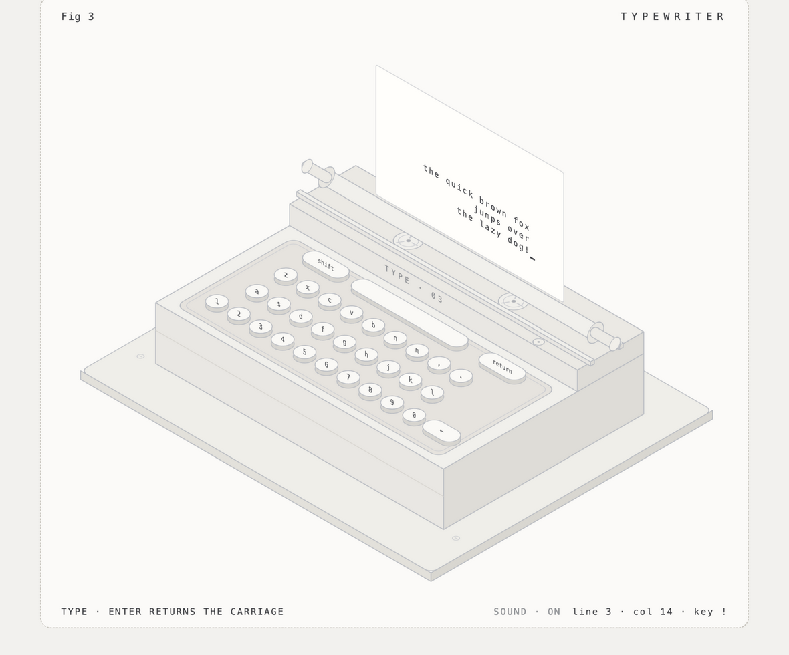

# Typewriter DEMO

An interactive isometric typewriter, drawn entirely with SVG and animated with CSS + vanilla JavaScript — no frameworks, no build step, no external assets.



## Run it

Open `Typewriter.html` in any modern browser. That's it — everything (drawing, animation, sound) lives in the one file.

## What it does

- **Type anything** — physical keyboard input appears on the paper at the platen. The current line slides left as you type, just like a real carriage, so text lands flush-right and ragged-left.
- **Enter returns the carriage** — the whole roller assembly kicks right with a spring, the paper feeds up one line, and you get a "zing… clack".
- **Margin bell & stop** — the bell dings (and flashes) near the right margin; at the margin the machine refuses to type and nudges you toward the return key.
- **Every key has feedback** — on-screen keys dip and flash orange when struck, whether pressed by mouse/touch or mirrored from your physical keyboard.
- **Clickable parts** — the platen knobs feed the paper one line, the ribbon spools spin, Shift toggles caps-latch (labels flip case), Backspace deletes (and un-returns at line start).
- **Status line** — live `line · col · key` readout in the footer, in the spirit of an instrument panel.
- **Synthesized sound** — keystrokes, space thock, margin bell, carriage zip and paper-feed ratchet, all generated with the Web Audio API. Toggle with **SOUND · ON/OFF**. No audio files.

## Tech notes

- The machine is generated programmatically: a small isometric projection helper (`iso(x, y, z)`) places every face, keycap and knob, so the geometry stays consistent at ~30°.
- Paper text is real SVG `<text>` laid on a skewed plane that matches the paper's projection, with a clip path at the sheet edges.
- All one-shot animations use the Web Animations API; the cursor blink and hover states are pure CSS.

## Files

```
Typewriter.html   — the whole demo (markup + styles + script, fully commented)
docs/screenshot.png
```

## License

MIT — see [LICENSE](LICENSE).
